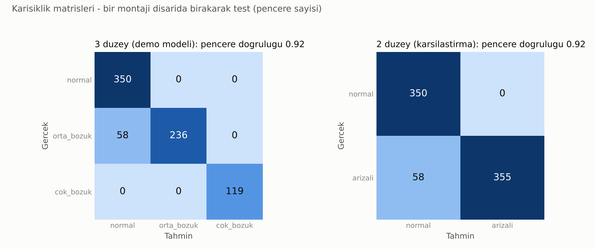
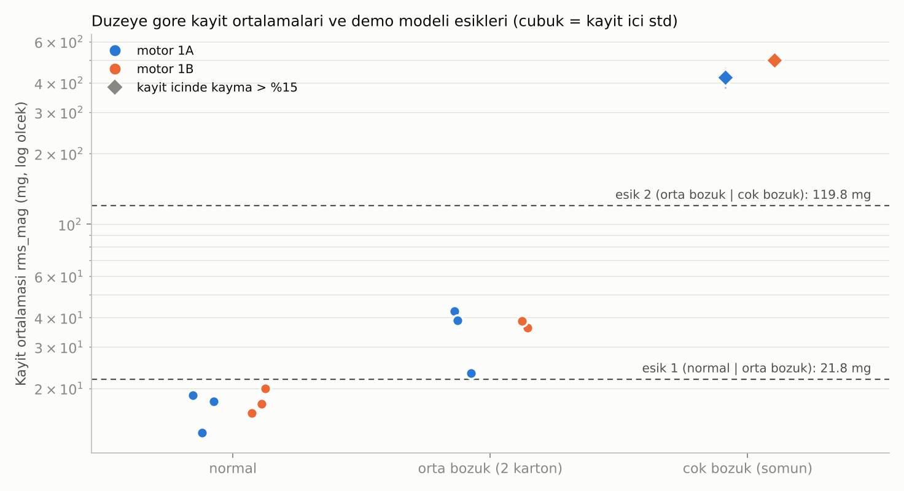

# Egitim sonuclari (otomatik uretildi: 2026-10-27 19:31)

## Veri
- **Kaynak: gercek olcum.** GY-521 (MPU-6500 uyumlu) + STM32F407, 1 kHz ornekleme, 1024 ornekli pencere, +-4 g.
  Sentetik veri kullanilmadi.
- Motorlar: 1A ve 1B (ayni tip, silindir, 5 V ayar). Duzeyler: normal (agirlik yok), orta bozuk (milde 2 karton parcasi), cok bozuk (milde lehimli somun).
- Kullanilmayan kayitlar (tek karton, bu modelde yer almiyor): m1B_bozuk_5V_mt2_r3_20261027_121631.csv, m1A_bozuk_5V_mt2_r4_20261027_122138.csv, m1B_bozuk_5V_mt5_r9_20261027_125104.csv, m1A_bozuk_5V_mt5_r10_20261027_125339.csv, m1A_bozuk_5V_mt8_r15_20261027_163513.csv.
- 13 kayit, 763 temiz pencere (2 glitch penceresi atildi).
  Her kayit ayri bir montaj: 1A icin 7, 1B icin 6 montaj. Bagimsiz ornek sayisi bu.
- Ozellik: yalnizca `rms_mag` (mg).

| Duzey | Kayit | Kayit ortalamasi araligi (mg) | Ort. (mg) |
|---|---|---|---|
| normal (agirlik yok) | 6 | 12.9 - 19.9 | 17.0 |
| orta_bozuk (2 karton) | 5 | 23.1 - 42.6 | 35.9 |
| cok_bozuk (lehimli somun) | 2 | 421.2 - 498.9 | 460.1 |

## Test yontemi
Her sinamada bir montaj (veya bir motor) tamamen disarida birakilip tahmin ettirildi. Esikler yalnizca kalan veriden secildi.
Ayni kaydin pencereleri hem egitimde hem testte yer almadi. "5'li oy": son 5 tahminin ortancasi (STM32'deki oylama gibi).
Esikler, egitim verisindeki iki sinif arasindaki boslugun geometrik ortasina yerlestirildi.

## Sonuc
| Senaryo | Sinif | Pencere dogr. | 5'li oy | Kayit karari (%95 aralik) | Motor disarida | Esikler (mg, tum veri) |
|---|---|---|---|---|---|---|
| A (tum kayitlar) | 3 duzey | 0.92 | 0.92 | 12/13 (%67-%99) | 0.91 | 21.8, 119.8 |
| A (tum kayitlar) | 2 duzey | 0.92 | 0.92 | 12/13 (%67-%99) | 0.91 | 21.8 |

## Demo modeli: 3 duzey
- Kural: `rms_mag < 21.84 mg` normal, `21.84 - 119.84 mg` orta bozuk, `>= 119.84 mg` cok bozuk
  (STM32 icin: 21844 ug ve 119839 ug).
- Montaj disarida pencere dogrulugu 0.92, kayit karari 12/13, motor disarida 0.91.
- Yanlis giden kayitlar: m1A_cok_bozuk_5V_mt3_r6_20261027_123810.csv (gercek orta_bozuk, karar normal).
- Bu sonuc ayni tip iki motorla yapilmis bir **demodur**; kor test yapilmamistir ve gelistirilmelidir.

## Karsilastirma: 2 duzey (normal / arizali)
- Tek esik `rms_mag >= 21.84 mg` -> arizali. Montaj disarida pencere dogrulugu 0.92, kayit karari 12/13.
- Yanlis giden kayitlar: m1A_cok_bozuk_5V_mt3_r6_20261027_123810.csv (gercek arizali, karar normal).

## Sinirliliklar (rapora aynen yazilmali)
- Ayni tip yalnizca 2 motor (tek tip motor uzerinde demo), tek sensor konumu, kayit basina tek montaj; bagimsiz ornek sayisi 13; cok bozuk (somun) sinifinda yalnizca 2 kayit (motor basina 1).
- Agirliklar el yapimi (karton parcalari, lehimli somun), kutleleri tartilmadi; 1A'da ayni agirlikla kayitlar arasi buyuk fark var.
- Somunlu kayitlarda iki deneme motor kayit sirasinda durdugu icin atildi (data_v2/atilan).
- Pencerelerin yuzde 15'ten fazla kayan kayitlari (motor isinmasi veya agirlik oynamasi) var: m1A_dengesiz_5V_mt12_r20_20261027_185046.csv, m1B_dengesiz_5V_mt9_r21_20261027_184202.csv.
- Esikler ayni 13 kayit uzerinde secildi; **henuz gorulmemis yeni kayitlarla kor test yapilmadi.** STM32 uzerinde de denenmedi.
- Sonuc "bu duzenekte" gecerlidir; baska motor/sensor/montaj icin genelleme iddiasi yoktur.
- Calisma, kestirimci bakim degil, mevcut titresimden durum siniflandirmadir.
